<div align="center">

# BiCAM

### What Helps—and What Hurts: Bidirectional Explanations for Vision Transformers

[](https://www.python.org/)
[](https://pytorch.org/)
[](#verified-scope)
[](.github/workflows/ci.yml)

**Bidirectional class activation maps that reveal both supportive and
suppressive evidence behind Vision Transformer predictions.**

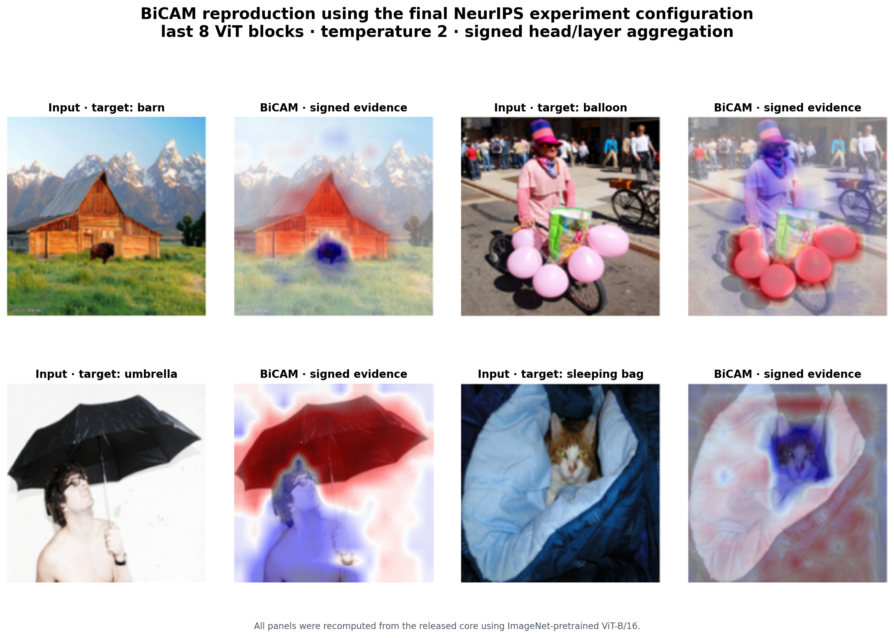

</div>

<sub>Results generated with the current repository using the exact ViT-B/16
checkpoint and preprocessing from the final experiment notebook. The method
aggregates the last eight transformer blocks with temperature 2. Red denotes
supportive evidence and blue denotes suppressive evidence.</sub>

## What this repository provides

- **Signed ViT heatmaps:** red supports the target class; blue suppresses it.
- **One forward/backward pass:** no explainer training is required.
- **A verified example:** the included barn image reproduces the final notebook
  configuration with ViT-B/16, the last eight blocks, and `T = 2`.
- **Small public API:** prediction, signed attribution, and positive/negative
  maps are returned together.

The core method captures CLS attention logits, value vectors, and
class-specific gradients from the last eight transformer blocks, then sums the
signed evidence across heads and layers.

## Installation

```bash
git clone https://github.com/TrustAIoT/BiCAM-ViT.git
cd BiCAM
pip install -e ".[viz]"
```

## Generate a heatmap

```bash
python examples/quickstart.py
```

The first run downloads the 330 MB paper checkpoint and then writes
`bicam_barn_overlay.png`. To use another image or class, change `image_path`
and `target` in [`examples/quickstart.py`](examples/quickstart.py). The complete
example deliberately stays in one file so it is easy to copy into another
project.

```python
result = explainer.generate(tensor, target=425)
heatmap = result.attribution       # signed [B, 1, H, W]
positive = result.positive         # supportive evidence
negative = result.negative         # suppressive evidence
```

## Verified scope

The maintained path is **ViT-B/16 at 224 × 224** with the explicit checkpoint
and preprocessing used by the final experiment notebook.

## Explore qualitative results

Choose a dataset, then expand only the method you want to inspect. Each compact
preview pairs the input image with that method's heatmap. The complete
publication figures remain in [`assets/supplement`](assets/supplement).

<details>
<summary><b>ImageNet</b></summary>

<details>
<summary>BiCAM</summary>
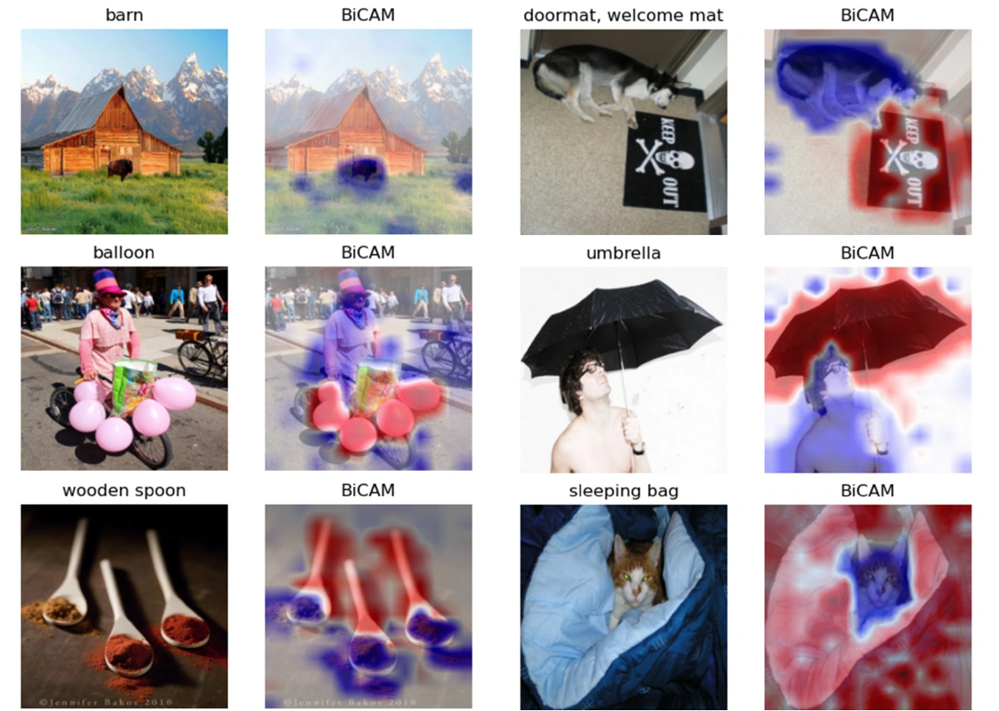
</details>

<details>
<summary>Attention Rollout</summary>
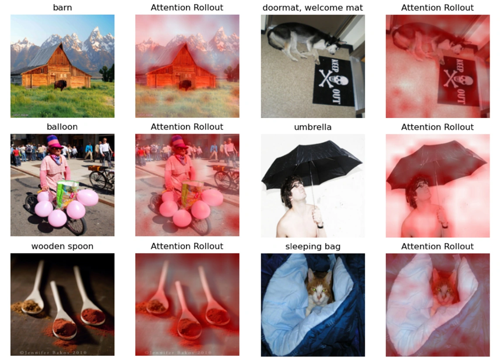
</details>

<details>
<summary>LRP-based</summary>
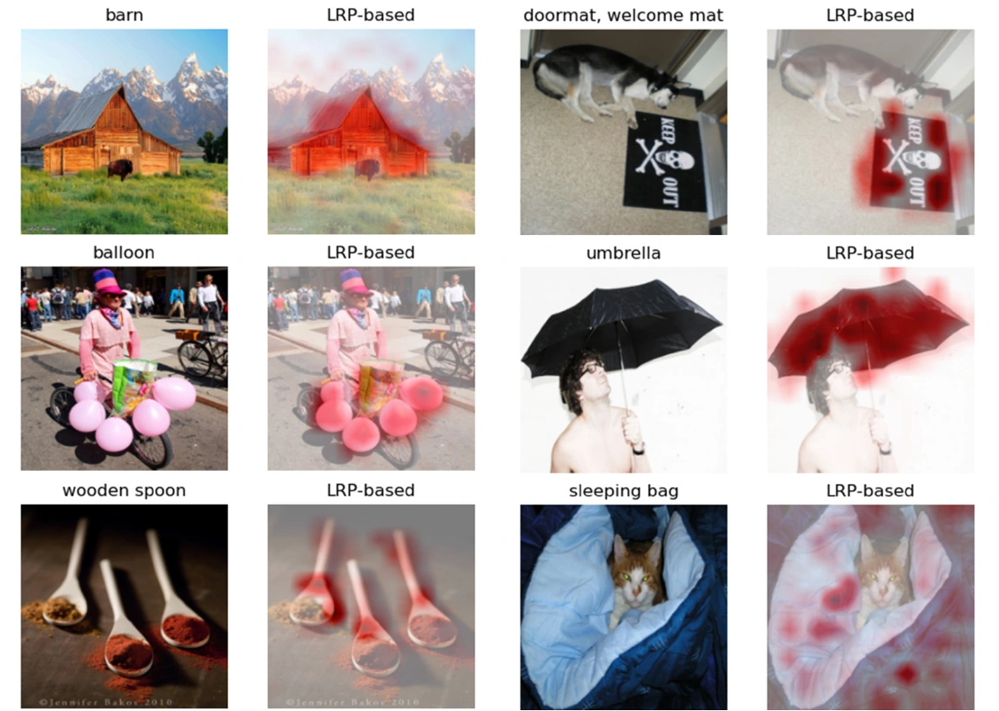
</details>

<details>
<summary>AGCAM</summary>
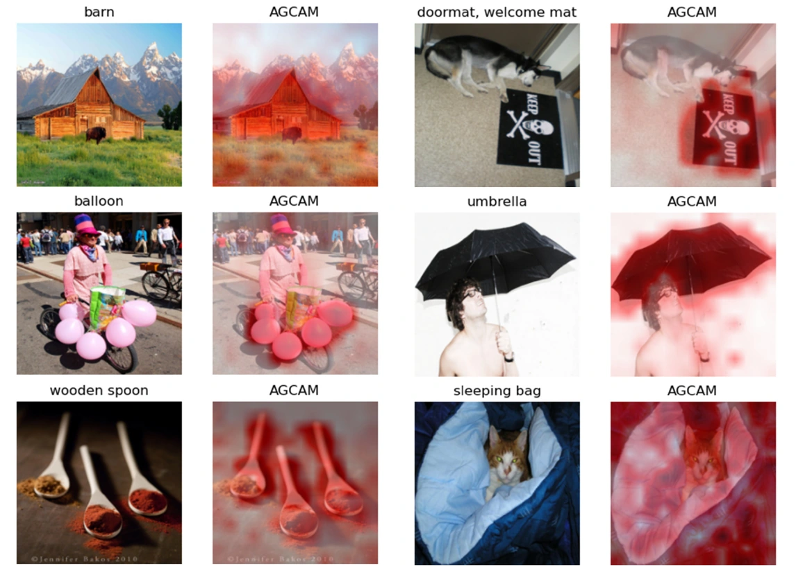
</details>

</details>

<details>
<summary><b>PASCAL VOC</b></summary>

<details>
<summary>BiCAM</summary>
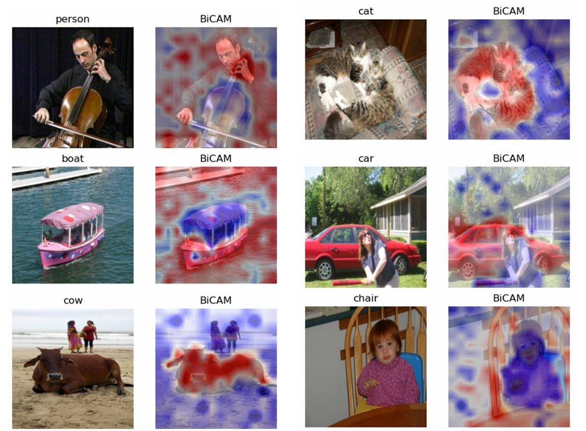
</details>

<details>
<summary>Attention Rollout</summary>
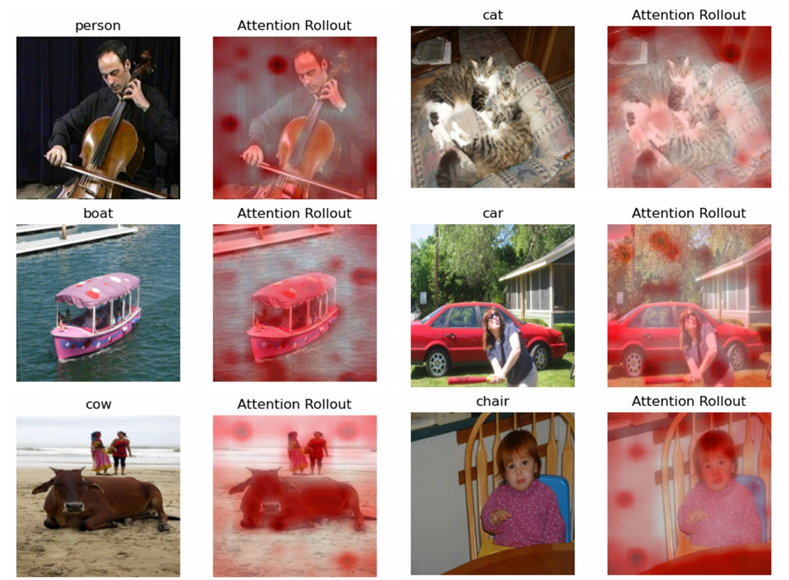
</details>

<details>
<summary>LRP-based</summary>
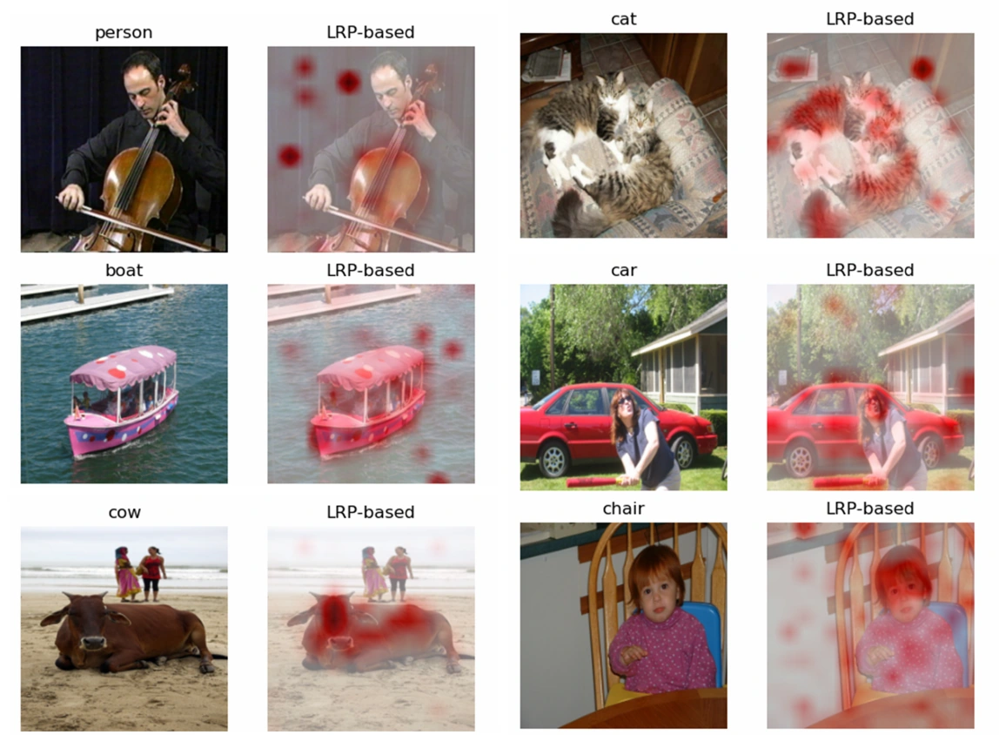
</details>

<details>
<summary>AGCAM</summary>
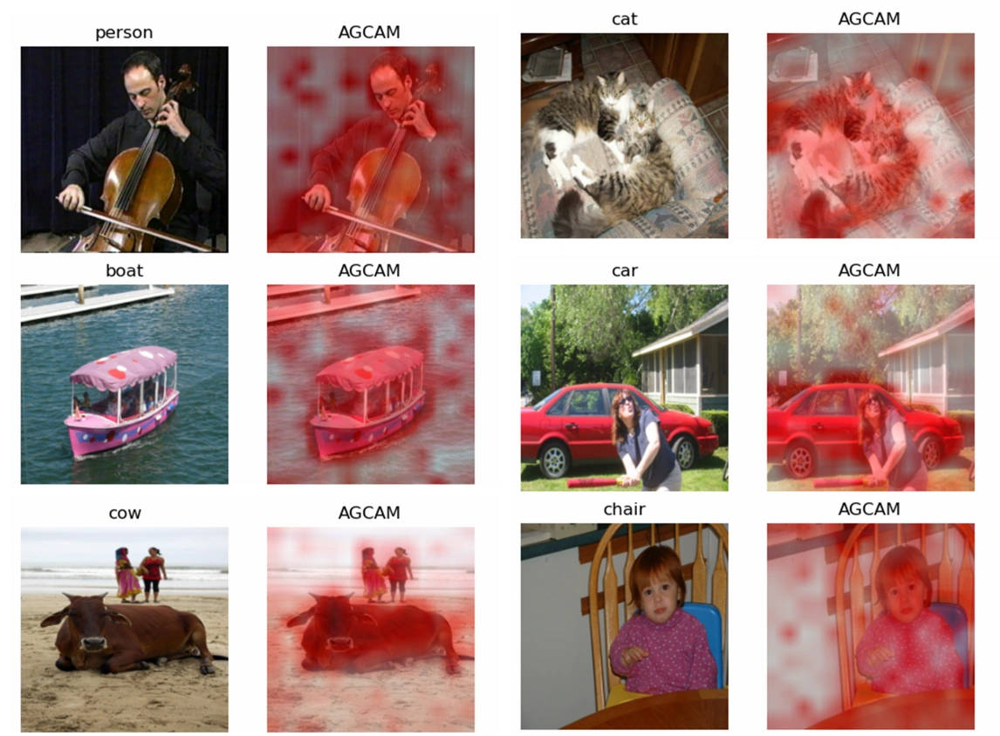
</details>

</details>

<details>
<summary><b>CUB-200</b></summary>

<details>
<summary>BiCAM</summary>
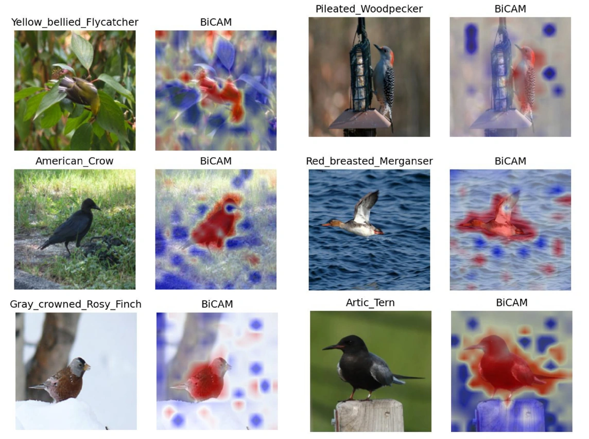
</details>

<details>
<summary>Attention Rollout</summary>
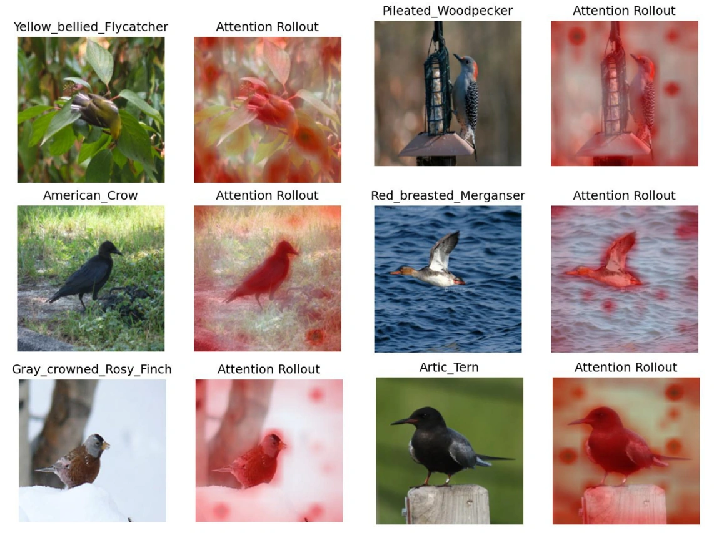
</details>

<details>
<summary>LRP-based</summary>
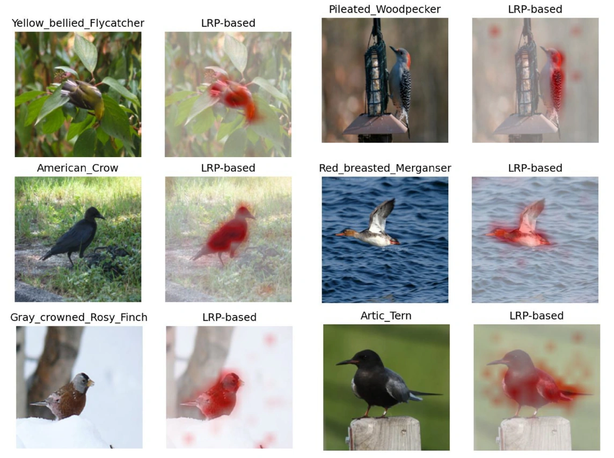
</details>

<details>
<summary>AGCAM</summary>
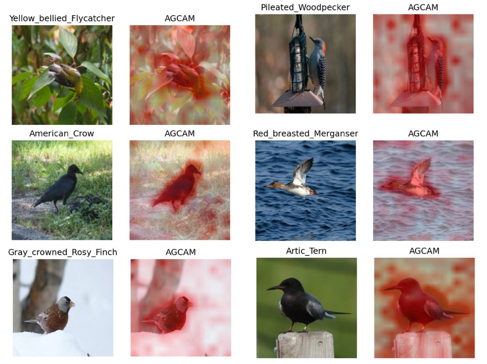
</details>

</details>

Reported benchmark tables and additional robustness figures are available in
[`docs/results.md`](docs/results.md) and [`assets/supplement`](assets/supplement).

## Repository layout

```text
BiCAM/
├── src/bicam/        # BiCAM core and visualization helpers
├── examples/         # One runnable heatmap example
├── tests/            # Lightweight unit tests
├── docs/             # Reported results and configuration notes
└── assets/           # Example input and publication figures
```

#### Check out paper on [Springer](https://link.springer.com/chapter/10.1007/978-981-92-1947-6_41) or [arXiv](https://arxiv.org/abs/2603.01605)

## Reproducibility notes

The runnable example uses the same direct 224 × 224 resize, `0.5`
normalization, explicit ViT-B/16 checkpoint, last-eight-block aggregation, and
temperature `2` as the final notebook.

## Citation

```bibtex
@inproceedings{su2026helps,
  title={What Helps—and What Hurts: Bidirectional Explanations for Vision Transformers},
  author={Su, Qin and Luo, Tie},
  booktitle={Pacific-Asia Conference on Knowledge Discovery and Data Mining},
  pages={510--522},
  year={2026},
  organization={Springer}
}
```

## License

Copyright © 2026 TrustAI Group. The repository is currently marked
**all rights reserved** until TrustAI Group selects an open-source license.
